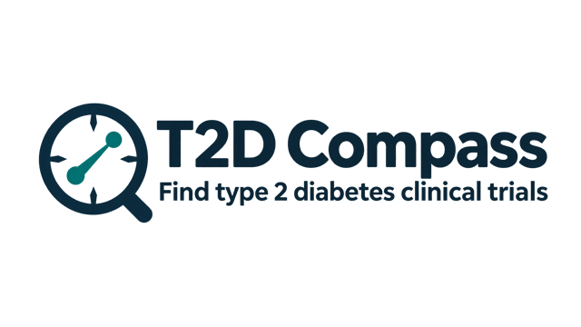
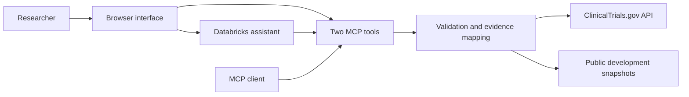

<p align="center">
  
</p>

# T2D Compass

Find completed type 2 diabetes studies and review their registry evidence in one place.

[Open the app](https://t2d-compass-7474654188777746.aws.databricksapps.com/) · [Quick start](QUICKSTART.md) · [Deliverables](deliverables/README.md) · [Evaluation](docs/EVALUATION.md) · [Documentation](docs/README.md)

[](https://github.com/imtiaz-cdc/T2D-compass/actions/workflows/ci.yml)

T2D Compass helps researchers find completed intervention studies on ClinicalTrials.gov and inspect study design, enrollment, eligibility, interventions, primary outcomes, and results availability. Each evidence card links back to the registry and retains source field paths, missing values, and review flags. Search, card retrieval, and exports are available in the browser; a Databricks assistant uses the same MCP tools to answer research questions.

**Current version:** 0.4.1 · **Data source:** ClinicalTrials.gov · **Deployment:** Databricks Apps

The hosted app requires authorized Databricks access. Local search and evidence cards can run against included public snapshots without model credentials.

## What you can do

- Search for completed, interventional studies using an optional intervention term.
- Open a study by NCT identifier and inspect its source-linked evidence card.
- Review each registered primary outcome alongside its original timeframe.
- Distinguish study completion from posted results and eligibility from enrolled participants.
- Export cards and assistant traces as JSON for further review.

## MCP tools

| Tool | Input | Output |
| --- | --- | --- |
| `find_completed_trials` | Optional intervention text; 1–5 results | Bounded candidates with source links, scope checks, and search-coverage notes |
| `get_trial_evidence_card` | NCT identifier | Study details, primary outcomes and timeframes, results status, provenance, and review flags |

Both tools are read-only. Search screens for supported type 2 diabetes condition labels. Direct identifier lookup can return a study outside that scope, with a warning. See the [tool contracts](docs/ARCHITECTURE.md) and [field dictionary](docs/FIELD_DICTIONARY.md).

## Run locally

Install Python 3.11+ and [uv](https://docs.astral.sh/uv/getting-started/installation/), then:

```sh
git clone https://github.com/imtiaz-cdc/T2D-compass.git
cd T2D-compass
uv sync --locked --group dev
```

Start the browser interface with public development snapshots:

```sh
ALZ_COMPASS_DATA_MODE=snapshot MCP_TRANSPORT=streamable-http uv run python main.py
```

Open [localhost:8000](http://127.0.0.1:8000). The [quick start](QUICKSTART.md) includes PowerShell commands, live registry mode, MCP client setup, and configuration. Run `uv run python main.py` without these overrides to start the default stdio MCP server.

The package name `alz_compass` and `ALZ_COMPASS_*` settings are retained for deployment compatibility. The app, data, tools, and current evaluation suite use the type 2 diabetes scope.

## Architecture



The registry adapter selects live or snapshot data. Mapping preserves source values and field paths. Assistant responses retain tool traces; version 0.4.1 checks primary-outcome and timeframe blocks and uses the retrieved source cards when those blocks differ. The original model draft remains available in the trace.

## Evaluation

Version 0.4.1 passed **310 software tests and lint**. Two hosted checks on November 23, 2026 preserved all **five reviewed primary-outcome/timeframe pairs**. These checks cover selected cases, not every possible model response.

The [evaluation report](docs/EVALUATION.md) documents the software checks, 24 recorded scenario executions, team assessments, reference-source audit, and their respective methods and limitations. Dated evidence and the original frozen reference candidate are preserved under [`eval/type2diabetes/`](eval/type2diabetes/).

```sh
uv run python -m pytest -q
uv run python -m ruff check src tests main.py scripts/build_bundles.py scripts/collect_type2diabetes_data.py
uv run python -m alz_compass.verify --output eval/type2diabetes/results/my-snapshot-replay.json
```

## Repository guide

| Location | Contents |
| --- | --- |
| [`src/alz_compass/`](src/alz_compass/) | MCP tools, registry adapter, evidence mapping, assistant, and browser interface |
| [`tests/`](tests/) | Unit, transport, integration, and controlled model tests |
| [`data/type2diabetes/`](data/type2diabetes/) | Public registry snapshots, selection records, and source manifests |
| [`eval/type2diabetes/`](eval/type2diabetes/) | Scenario suite and dated evaluation evidence |
| [`docs/`](docs/README.md) | Architecture, deployment, evaluation, and data contracts |
| [`deliverables/`](deliverables/README.md) | Evaluation report, code submission, and supporting review records |
| [`scripts/`](scripts/README.md) | Data collection and reproducible packaging |
| [`deploy/`](deploy/README.md) | Deployment templates and documented compatibility files |

## Research use

T2D Compass supports review of registry records. It does not extract numerical outcome results, rank treatments, prescribe care, or establish treatment effectiveness. Registry omissions and inconsistencies remain visible. The search is bounded and may omit relevant studies with broader condition labels.

Use public data only. Keep credentials, patient information, and private prompts out of commits and shared traces. See the [security policy](SECURITY.md).

## Team

- Md Imtiaz Khalil Ullah
- Chinelo Njoku
- Mohammad Alpha Jalloh

Public Health Informatics Fellows, Office of Informatics and Information Resource Management, National Center for Chronic Disease Prevention and Health Promotion, Centers for Disease Control and Prevention.

## License and acknowledgments

[MIT License](LICENSE). The original Technology Transformation Services copyright notice is retained. Template history and data attribution are recorded in [provenance](docs/PROVENANCE.md). The project does not imply agency or vendor endorsement.
