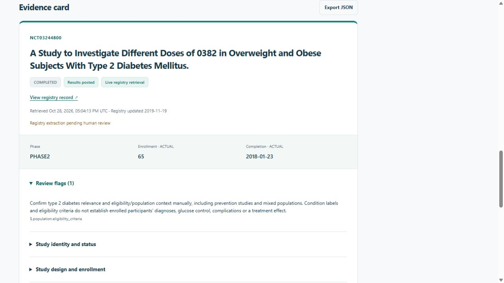
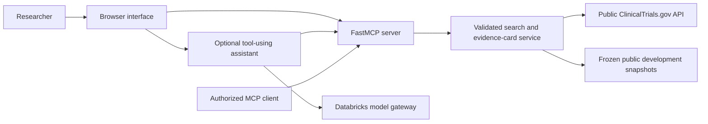

# T2D Compass

**Traceable ClinicalTrials.gov evidence for researchers reviewing completed type 2 diabetes intervention studies.**

T2D Compass is an independent hackathon prototype built with the [GSA MCP server template](https://github.com/GSA-TTS/mcp-hackathon-template). It turns public registry records into structured evidence cards with source links, field-level provenance, results-availability labels, and explicit review flags. A browser interface supports search, card inspection and JSON export. An optional Databricks assistant uses the same two MCP tools to answer research questions.

**Version:** 0.4.0 · **Data source:** ClinicalTrials.gov only · **Platform:** Databricks Apps

[Open the app](https://t2d-compass-7474654188777746.aws.databricksapps.com) · [Quick start](QUICKSTART.md) · [Evaluation report](docs/EVALUATION.md) · [Presentation](presentation/README.md) · [Submission checklist](docs/SUBMISSION.md)

The hosted app requires authorized Databricks access. Authorized browser search, card retrieval, scope warnings and exports were verified on November 23. Nine direct browser checks passed. Two hosted assistant attempts failed with `model_authentication_failed` and zero tool calls, including one retry after reopening the app. This is an observed authentication limitation, not a passing live model suite.

## Problem and mission

Researchers repeatedly collect trial identifiers, study designs, enrollment labels, interventions, registered outcomes and results availability from registry records. Missing information and differences in wording make these records easy to misinterpret. T2D Compass prepares a consistent, inspectable starting point for that work, with the source attached to each extracted fact. It supports use of public federal research data without claiming a measured time saving, treatment benefit or clinical validation.

## Implemented capabilities

| MCP tool | Inputs | Result |
| --- | --- | --- |
| `find_completed_trials` | Optional intervention text; result limit 1–5 | Bounded candidates screened for completed/interventional status and explicit supported type 2 diabetes condition labels; source links and coverage limits |
| `get_trial_evidence_card` | `NCT` plus eight digits | Study design, enrollment and actual/estimated label, eligibility, arms and interventions, every primary outcome/timeframe, posted-results status, provenance and review flags |

Both tools are read-only. Browser controls invoke MCP inside the app. The optional assistant records model/tool calls and supports trace export. A direct NCT lookup can return an out-of-scope study with warnings; search applies the stricter candidate screen.



*Local browser evidence captured October 28, 2026. This is software-demonstration evidence, not a new deployed model result.*

## Architecture



The source adapter selects live registry or snapshot mode. The mapper retains missing values, source field paths and review flags. [Architecture and tool contracts](docs/ARCHITECTURE.md) describe the boundaries and transport choices.

## Run locally

Use Python 3.11 or later and [uv](https://docs.astral.sh/uv/). Run from this repository root:

```sh
uv sync --locked --group dev
uv run python main.py
```

This starts the MCP server over **stdio**, for a local MCP client. To open the browser interface instead:

```powershell
$env:ALZ_COMPASS_DATA_MODE = "snapshot"
$env:MCP_TRANSPORT = "streamable-http"
uv run python main.py
```

Open [localhost:8000](http://127.0.0.1:8000). Search and evidence cards work without model credentials. The optional assistant requires the Databricks user-authorization path. macOS/Linux instructions, a local client example, configuration and live mode are in [QUICKSTART.md](QUICKSTART.md).

The distribution and module keep the compatible name `alz-compass` / `alz_compass`, and settings keep `ALZ_COMPASS_*`. The displayed app, disease rules, prompt, fixtures and current evaluation suite are T2D Compass. These internal names do not select the earlier disease scope.

## Verify and evaluate

```sh
uv run python -m pytest -q
uv run python -m ruff check src tests main.py scripts/build_bundles.py scripts/collect_type2diabetes_data.py
uv run python -m alz_compass.verify --output eval/type2diabetes/results/my-snapshot-replay.json
uv run python -m alz_compass.verify_http --output eval/type2diabetes/results/my-http-check.json
```

The [evaluation report](docs/EVALUATION.md) separates automated software tests, actual MCP tool replays, model evaluation and independent clinical review. **November 12 verification passed 294 tests, lint, live and snapshot MCP replays, local HTTP checks, and generated-package startup.** Reports are under [`eval/type2diabetes/results/submission-2026-11-12/`](eval/type2diabetes/results/submission-2026-11-12/). The preserved October 28 evidence retains its original date.

The November 21 archive contains **24 completed model executions** (12 scenarios twice). Chinelo's and Mohammad's supplied reviews report **12/12 scenario passes and 7/7 critical passes in each run**. The November 23 assistant source audit completed all **140 configured reference groups**, with **84/84 development groups, 56/56 held-out groups and 10/10 whole cards matching**. These are separate evidence types; the reference audit does not claim independent human clinical approval.

The dated [delivery package](deliverables/2026-11-23/README.md) includes the updated narrated evidence walkthrough, evaluation PDF, slide deck and public-code-link PDF. [Reference annotations and results](eval/type2diabetes/results/reference-audit-2026-11-23/README.md) preserve actual values, source checks, first-run results and limitations. The frozen baseline remains ten core records plus one separate active-study exclusion.

## Repository map

```text
main.py, app.yaml           Local and Databricks entry point/configuration
pyproject.toml, uv.lock     Package metadata and locked dependencies
requirements.txt           Locked runtime dependencies for Databricks
src/alz_compass/            MCP tools, mapping, registry adapter, agent and browser
tests/                     Software, transport and synthetic model tests
data/type2diabetes/         Public snapshots, manifests and original review form
eval/type2diabetes/         Scenario suite, bindings and dated evidence
docs/                      Architecture, evaluation, security and submission
deploy/                    Packaging template and labeled historical connector
scripts/                   Public-data collector and reproducible bundle builder
presentation/              T2D slide deck and presentation access information
```

## Deployment

Use [Databricks deployment guidance](docs/EASY_DEPLOY.md). The browser app uses user authorization for model calls and the assigned environment's configured model. External `/mcp` access needs its own supported authentication. Repository publication does not alter the deployed app or its permissions.

## Research and security boundaries

This prototype prepares registry evidence for human review. It does not extract numerical outcome results, rank treatments, prescribe care, establish clinical equivalence or replace a systematic review. Completed status is separate from posted results. Eligibility describes entry criteria, not the actual enrolled population. The conservative type 2 diabetes label screen can omit relevant studies with broader labels.

Only public registry data and labeled synthetic fixtures belong in this project. Keep credentials and private prompts out of commits and shared traces. The hosted deployment remains within authorized Databricks access. See [security](SECURITY.md), the [field dictionary](docs/FIELD_DICTIONARY.md) and [dataset provenance](data/type2diabetes/README.md).

## Team and provenance

Imtiaz leads the project and repository. Chinelo leads delivery and evaluation. Mohammad leads clinical source and interpretation review. Their November 21 documents supply scenario assessments. The November 23 source audit is explicitly assistant-authored and does not sign on either reviewer's behalf.

Adapted from the GSA starter at commit `6e5fb39b4de044de4f39950ded44fa128416f11a`; aligned with the current template structure at `f39249f1768309e3ef8b31742390a4f3a656b5f3` on November 12, 2026. See [provenance](docs/PROVENANCE.md). [MIT license](LICENSE), retaining the original Technology Transformation Services notice. This independent prototype does not imply endorsement by GSA, CDC or any vendor.

The user subsequently reported that the hosted assistant also failed in a private browser session. No successful live assistant result is claimed. Detailed operational diagnostics are retained locally.
